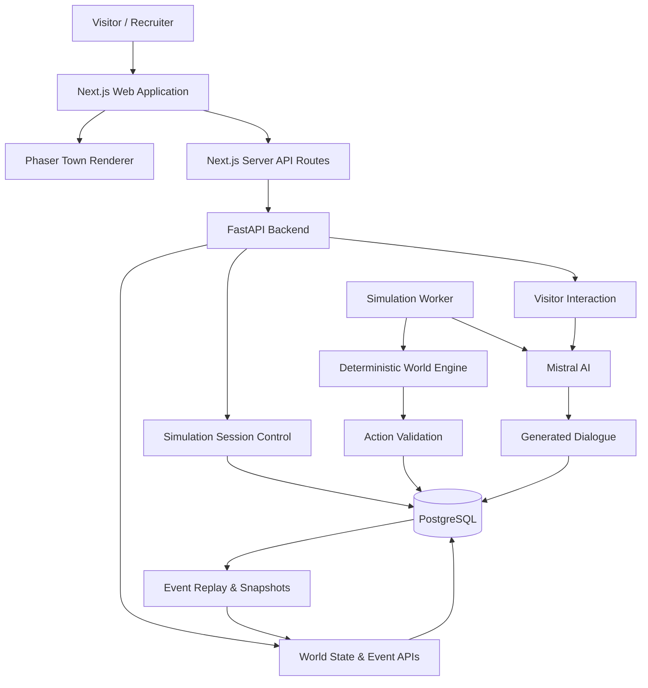

<div align="center">

# 🏙️ Living AI Town

### A Persistent, Event-Sourced Multi-Agent World

*A living simulation where AI characters follow daily routines, interact with one another, respond to visitors, and inhabit a persistent, replayable world.*


[](https://www.python.org/)
[](https://fastapi.tiangolo.com/)
[](https://www.postgresql.org/)
[](https://nextjs.org/)
[](https://www.docker.com/)
[](https://cloud.google.com/)
[](https://vercel.com/)

<a href="https://living-ai-town.vercel.app/">
  
</a>

<br/>

**🌐 [Experience the Living AI Town Simulation](https://living-ai-town.vercel.app/)**


</div>

---

## 🌍 Overview

Most LLM demonstrations follow a familiar pattern:

**User sends a message → model generates a response → interaction ends.**

Living AI Town explores a different problem:

> What does it take to build an AI-powered world that continues to exist independently of any single conversation, preserves its history, and can reconstruct its state after failures?

Living AI Town is a persistent multi-agent simulation with a deterministic world engine, LLM-generated character dialogue, event-sourced state transitions, and an interactive web interface.

Three characters inhabit a small virtual town. They move between locations, follow daily schedules, encounter one another, exchange dialogue, and interact with visitors.

The important distinction is that **the language model does not control the authoritative world state**.

Instead, the simulation engine determines valid state transitions, while Mistral AI contributes natural-language dialogue.

This separation makes the world easier to validate, reproduce, debug, and recover.

### Core capabilities

- **Persistent world state** backed by PostgreSQL
- **Multiple AI characters** with distinct identities and routines
- **LLM-generated conversations** between characters
- **Visitor-to-agent interactions** through the web interface
- **Deterministic simulation ticks** independent of wall-clock time
- **Event-sourced architecture** with an append-only history
- **Exact state reconstruction** through event replay
- **Database snapshots** for efficient recovery
- **Idempotent operations** to protect against duplicate execution
- **Transactional state updates** for consistency
- **Concurrency and crash-recovery testing**
- **Interactive Phaser-based visualization**
- **On-demand simulation sessions** with manual and automatic stopping
- **Cloud deployment** with a containerized backend and hosted frontend

---

## 🎮 Meet the Town

The initial town contains three characters:

| Character | Role | Behavior |
|---|---|---|
| 🥐 Emma | Baker | Follows a daily routine between her workplace, town square, and home |
| 📚 Noah | Teacher | Moves through his scheduled activities and interacts with other residents |
| 🛍️ Sophia | Shopkeeper | Runs her daily routine and participates in town conversations |

Each character has an identity, a location, and a place within the simulated world.

Characters can:

1. Move between predefined locations.
2. Follow their daily schedules.
3. Meet and exchange AI-generated dialogue.
4. Receive messages from visitors.
5. Continue from previously persisted world state.

### What is AI-driven?

**Mistral AI generates dialogue.**

The deterministic engine controls simulation progression, movement, scheduling, and authoritative state transitions.

This is an intentional architecture decision: the system demonstrates how LLM-generated behavior can be integrated into a reliable, rule-governed simulation without allowing unconstrained model output to corrupt world state.

The current implementation is **not a fully autonomous planning system** in which each agent independently invents and executes arbitrary long-term plans.

---

## 🏗️ System Architecture



### Architecture principles

**1. The database is authoritative.**

The frontend renders the world but does not decide which state transitions are valid.

**2. Simulation time is explicit.**

World progression is represented by logical ticks rather than relying on browser animation timing or wall-clock movement.

**3. Events provide an auditable history.**

Accepted actions are recorded so the world can be reconstructed and inspected.

**4. LLM output is separated from world authority.**

Generated dialogue enriches interactions without replacing deterministic state validation.

**5. Recovery is designed into the system.**

Transactions, idempotency, snapshots, and replay support consistent execution across retries and failures.

---

## ⚙️ Event-Sourced World Engine

The central engineering challenge is not rendering moving characters.

It is maintaining a world whose state remains consistent across execution, retries, process crashes, and restarts.

### Event sourcing

Instead of treating the current world state as the only source of information, Living AI Town records accepted state-changing events.

The database includes:

| Table | Responsibility |
|---|---|
| `ticks` | Tracks logical simulation progression |
| `decisions` | Records decisions and their execution identities |
| `events` | Stores the append-only event history |
| `event_context` | Preserves contextual information associated with events |
| `world_state` | Stores the current materialized world |
| `snapshots` | Stores replay checkpoints |
| `demo_session` | Tracks the active on-demand simulation window |

The event history makes it possible to inspect what happened and reconstruct the resulting world.

### Deterministic replay

The world engine supports two recovery paths:

**Full replay**

```text
Initial World
    |
    v
Event 1 → Event 2 → Event 3 → ... → Event N
    |
    v
Reconstructed World State
```

**Snapshot replay**

```text
Saved Snapshot
    |
    v
Events After Snapshot
    |
    v
Reconstructed World State
```

Both approaches are designed to produce the same final world state.

State hashes are used to verify replay fidelity.

### Why this matters

For persistent agent systems, a plausible-looking response is not sufficient.

The system must also answer:

- Was the action applied exactly once?
- Did it violate a world rule?
- Can the state be recovered after a crash?
- Can the execution history be inspected?
- Does replay reproduce the same result?

Living AI Town treats these as engineering requirements rather than optional enhancements.

---

## 🛡️ Reliability and Consistency

### Idempotency

Duplicate requests and repeated execution attempts must not create duplicate world events.

The system uses unique action identifiers and request identifiers to distinguish new operations from retries.

### Atomic transactions

World updates are committed transactionally.

If execution fails partway through a transaction, partial changes are rolled back instead of leaving the world in an inconsistent state.

### Concurrency control

The engine has been tested with concurrent workers attempting to advance the simulation.

The goal is to preserve consistent tick progression without duplicate logical execution.

### Crash recovery

The system has been tested against interrupted worker execution and database restarts.

Persisted state and event history allow execution to resume without reconstructing the world from volatile process memory.

### Append-only history

Database-level protections prevent ordinary mutation of recorded events.

This preserves the integrity of the historical event stream used for replay.

---

## 🧠 LLM Integration

Living AI Town uses the **Mistral API** to generate natural-language interactions.

The simulation distinguishes between two responsibilities:

| Responsibility | Owner |
|---|---|
| Tick progression | Deterministic engine |
| Character movement | Simulation rules |
| Daily schedules | Simulation rules |
| Valid state transitions | World engine |
| Persistent state | PostgreSQL |
| Character dialogue | Mistral AI |
| Visitor-facing responses | Mistral AI |
| Visual presentation | Next.js + Phaser |

This separation provides a controlled environment for experimenting with AI-generated character interactions.

It also makes the project easier to evaluate: deterministic world behavior can be tested independently of the variability of generated language.

---

## ⏱️ On-Demand Simulation

The public demo uses an explicit Start/Stop model rather than running LLM-powered simulation cycles continuously.

### Session behavior

```text
           Simulation Paused
                   |
                   v
           Visitor clicks Start
                   |
                   v
           120-second session
                   |
                   v
         Simulation advances ticks
             every 3 seconds
                   |
          +--------+--------+
          |                 |
          v                 v
     Visitor clicks     Timer expires
          Stop               |
          |                  |
          +--------+---------+
                   |
                   v
           Simulation Paused
```

### Controls

- **Start Simulation:** Activates a two-minute simulation session.
- **Stop Simulation:** Ends the active session early.
- **Automatic timeout:** Stops the session after 120 seconds.
- **Countdown:** Shows the remaining session time.
- **Persistent progress:** World state is retained between sessions.

Session state is stored in PostgreSQL, allowing the API and worker to coordinate.

The worker remains idle when no simulation session is active.

An LLM request already in progress may finish after Stop is requested.

### Why on-demand execution?

A public portfolio demo does not need to generate conversations continuously when nobody is watching.

On-demand execution reduces unnecessary scheduled LLM usage while preserving an interactive experience for visitors.

It does not eliminate infrastructure costs, and public interactions can still consume API credits.

---

## 🖥️ Interactive Frontend

The frontend combines **Next.js**, **TypeScript**, and **Phaser**.

It provides a visual representation of the persistent town rather than requiring visitors to inspect raw API responses.

### Experience

- Interactive town visualization
- Animated character movement
- Character inspection
- World activity and event visibility
- Visitor messaging
- Start/Stop simulation controls
- Live simulation countdown

The frontend communicates with FastAPI through server-side Next.js API routes.

This keeps the backend address configurable through a server-side environment variable.

### Frontend environment

```env
TOWN_API_URL=https://your-backend-host
```

The Mistral API key and PostgreSQL credentials are not required in the frontend deployment.

---

## 🗄️ Persistence and Recovery

PostgreSQL 16 stores the simulation's authoritative data.

The production deployment uses a Docker-managed persistent volume.

The system supports:

- Persistent world state across process restarts
- Recorded event history
- Replay from the beginning
- Replay from snapshots
- State-hash comparison
- Idempotent retries
- Transactional rollback
- Recovery after worker interruption

**Important:** Event replay and snapshots provide application-level recovery capabilities. They are not a replacement for independent database backups.

---

## 🧪 Testing and Validation

The project was developed with an emphasis on verifying correctness before cloud deployment.

### Validated scenarios

| Test area | What was verified |
|---|---|
| World engine | Deterministic state transitions |
| Event acceptance | Valid actions produce expected events |
| Action rejection | Invalid actions do not corrupt world state |
| Idempotency | Duplicate operations do not duplicate execution |
| Full replay | Event history reconstructs the world |
| Snapshot replay | Snapshot-based reconstruction matches full replay |
| State hashing | Replayed and live states produce matching hashes |
| Transaction rollback | Partial failures leave no partial world update |
| Worker crash | Interrupted execution can recover |
| Concurrent execution | Multiple workers preserve logical tick consistency |
| Same-tick retries | Repeated requests are deduplicated |
| Database restart | Persisted state survives PostgreSQL restart |
| Production startup | API, database, and worker start successfully |
| Session expiration | Simulation stops automatically after two minutes |
| Manual stop | Simulation session can be ended early |

### Development validation

Before the final deployment changes, the local test suite reached:

**78 passing tests**

The deployed system was subsequently checked for API health, database connectivity, idle worker behavior, and on-demand session control.

These are development validation results, not a claim that the current deployment has passed an independent security or load audit.

### Run tests locally

From the repository root, with development dependencies installed:

```bash
python -m pytest -q
```

Some integration tests require a configured PostgreSQL environment.

---

## 🧰 Technology Stack

| Layer | Technology |
|---|---|
| Language | Python 3.12, TypeScript |
| Backend API | FastAPI |
| AI model provider | Mistral AI |
| Simulation | Deterministic Python world engine |
| Database | PostgreSQL 16 |
| Persistence design | Event sourcing, materialized state, snapshots |
| Frontend | Next.js, React |
| Game visualization | Phaser |
| Containers | Docker, Docker Compose |
| Backend hosting | Google Cloud Compute Engine |
| Frontend hosting | Vercel |
| HTTPS reverse proxy | Caddy |
| Testing | pytest |
| Version control | Git, GitHub |

---

## ☁️ Production Deployment

Living AI Town is deployed using a lightweight split architecture.

### Google Cloud

A Compute Engine VM runs the backend services:

```text
Google Cloud Compute Engine
|
+-- Docker Compose
    |
    +-- PostgreSQL 16
    |
    +-- FastAPI
    |
    +-- Simulation Worker
```

The VM hosts the persistent database and worker, which need to retain state and coordinate across sessions.

### HTTPS

Caddy provides HTTPS termination and reverse proxies requests to the FastAPI service bound to localhost.

The public backend uses a free IP-derived hostname.

### Vercel

The Next.js frontend is deployed separately on Vercel.

Its server-side API routes communicate with the Google Cloud backend over HTTPS.

### Deployment design

The architecture intentionally separates:

- Persistent simulation infrastructure
- Public-facing frontend
- LLM API integration
- Authoritative database state

This keeps the browser lightweight while allowing the world to persist independently of individual visitor sessions.

---

## 🚀 Run Locally

### Prerequisites

- Git
- Docker
- Docker Compose
- Python 3.12 for local development
- Node.js and npm for the frontend
- Mistral API key for LLM-powered interactions

### 1. Clone the repository

```bash
git clone https://github.com/revanthpuvanes/living-ai-town.git
cd living-ai-town
```

### 2. Configure production-style environment

Create a local `.env.prod` file:

```env
TOWN_DB_PASSWORD=replace-with-a-strong-random-password
MISTRAL_API_KEY=replace-with-your-mistral-api-key
```

Never commit this file.

### 3. Start the backend

```bash
docker compose \
  -p living-ai-town \
  --env-file .env.prod \
  -f compose.prod.yaml \
  up -d --build
```

The backend is available locally at:

```text
http://127.0.0.1:8002
```

Check its health:

```bash
curl http://127.0.0.1:8002/health
```

### 4. Start the frontend

In a separate terminal:

```bash
cd web
npm install
TOWN_API_URL=http://127.0.0.1:8002 npm run dev
```

Open:

```text
http://localhost:3000
```

If port 3000 is already occupied, select another available port.

### 5. Stop the containers

```bash
docker compose \
  -p living-ai-town \
  --env-file .env.prod \
  -f compose.prod.yaml \
  down
```

**Do not use `down -v` unless you intentionally want to delete the Docker-managed database volume.**

---

## 🔌 API Overview

The FastAPI service exposes endpoints for reading the world and controlling the simulation.

| Method | Endpoint | Purpose |
|---|---|---|
| `GET` | `/health` | API and database health |
| `GET` | `/api/world` | Current world state |
| `GET` | `/api/events` | Recorded world events |
| `GET` | `/api/simulation` | Session status and remaining time |
| `POST` | `/api/simulation/start` | Start a two-minute session |
| `POST` | `/api/simulation/stop` | End the current session |
| `POST` | `/api/visitor-message` | Submit a visitor interaction |

### Example: Check simulation status

```bash
curl http://127.0.0.1:8002/api/simulation
```

Response when paused:

```json
{
  "active": false,
  "remaining_seconds": 0
}
```

### Example: Start simulation

```bash
curl -X POST \
  http://127.0.0.1:8002/api/simulation/start
```

### Example: Stop simulation

```bash
curl -X POST \
  http://127.0.0.1:8002/api/simulation/stop
```

The public deployment uses HTTPS.

---

## 🔍 Engineering Decisions

### Why event sourcing instead of only storing current state?

Because persistent simulations benefit from an inspectable history and reproducible recovery.

A current-state-only design cannot, by itself, explain how the world arrived at its present state.

### Why deterministic ticks?

Because authoritative world progression should not depend on browser frame rates, network latency, or wall-clock timing.

Logical ticks provide a consistent basis for scheduling, movement, testing, and replay.

### Why keep LLMs out of authoritative state transitions?

Because language-model output is probabilistic.

Separating generated dialogue from rule-validated world updates reduces the risk of inconsistent state and makes core behavior independently testable.

### Why PostgreSQL?

Because the simulation requires durable transactions, constraints, structured state, and reliable recovery.

### Why Docker?

Because the backend consists of multiple coordinated services that must run consistently across local and cloud environments.

### Why a persistent VM rather than a purely serverless backend?

Because the current architecture includes a continuously available database and a worker that coordinates simulation sessions.

The VM provides a straightforward deployment model for these stateful services.

### Why limit the public simulation to two minutes?

Because this is an interactive portfolio demonstration, not an always-running commercial simulation.

A bounded session allows visitors to experience the system while reducing unnecessary scheduled LLM calls.

---

## ⚠️ Current Scope and Limitations

Living AI Town is an engineering prototype and portfolio demonstration.

Its current boundaries are intentional:

- Characters follow predefined routines rather than independently planning arbitrary long-term goals.
- LLMs generate dialogue, not unrestricted world-changing actions.
- The initial town contains three characters.
- Simulation sessions are shared globally, not isolated per visitor.
- Public session controls do not impose a per-user daily usage quota.
- In-flight LLM requests may complete after a session stops.
- The deployment uses a single VM rather than a highly available distributed cluster.
- Database snapshots are not substitutes for external backups.

These limitations keep the implementation focused on **persistence, consistency, reproducibility, and controlled LLM integration**.

---

## 💡 What This Project Demonstrates

Living AI Town brings together several concepts relevant to production-oriented AI agent engineering:

**Agent systems**

- Multi-character interaction
- LLM-generated dialogue
- Persistent character context
- Visitor-to-agent communication
- Controlled model integration

**Backend engineering**

- FastAPI services
- PostgreSQL transactions
- Event sourcing
- Idempotency
- Concurrency control
- State recovery

**Reliability engineering**

- Deterministic execution
- Replay verification
- State hashing
- Snapshot recovery
- Crash testing
- Transaction rollback

**Deployment engineering**

- Containerized services
- Cloud-hosted backend
- Persistent database volumes
- HTTPS reverse proxy
- Server-side frontend API integration
- On-demand execution controls

The central lesson is that **building an AI-powered world requires more than generating convincing dialogue**.

It requires a reliable system that can validate actions, preserve history, recover state, and behave consistently even when execution is interrupted.

---

## 👨‍💻 Author

**Revanth Puvaneswaran**

MSc Computer Science — EPITA, Paris

AI Agent Engineering · Backend Systems · Data Engineering

---

